

  Tamanho do texto:
  <button onclick="diminuirFonte()" title="Diminuir texto" style="padding: 6px 12px; font-weight: bold; cursor: pointer; border: 1px solid #ccc; border-radius: 4px; background: #f8f9fa;">A-</button>
  <button onclick="resetarFonte()" title="Tamanho normal" style="padding: 6px 12px; font-weight: bold; cursor: pointer; border: 1px solid #ccc; border-radius: 4px; background: #f8f9fa;">A</button>
  <button onclick="aumentarFonte()" title="Aumentar texto" style="padding: 6px 12px; font-weight: bold; cursor: pointer; border: 1px solid #ccc; border-radius: 4px; background: #f8f9fa;">A+</button>
  
  <button onclick="window.print()" style="background-color: #0056b3; color: white; padding: 6px 16px; border: none; border-radius: 5px; font-size: 14px; cursor: pointer; box-shadow: 0 2px 4px rgba(0,0,0,0.2); margin-left: 10px;">
    🖨️ Imprimir ou baixar esta página
  </button>

# EVENTO DE SUSPENSÃO

Eventos de suspensão podem ser realizados em:

* **Contratações diretas sem disputa:** a partir da aba "Contratações encerradas".
* **Credenciamento:** a partir da aba "Contratação em andamento".
* **Licitações presenciais e eletrônicas e dispensas eletrônicas:** a partir da aba "Contratações em andamento", desde que antes da data de abertura da sessão pública.

---

## Passo a Passo para Suspensão

**Passo 1:** Acesse o Portal de Compras do Governo Federal e clique em “Acesso ao Sistema”. 

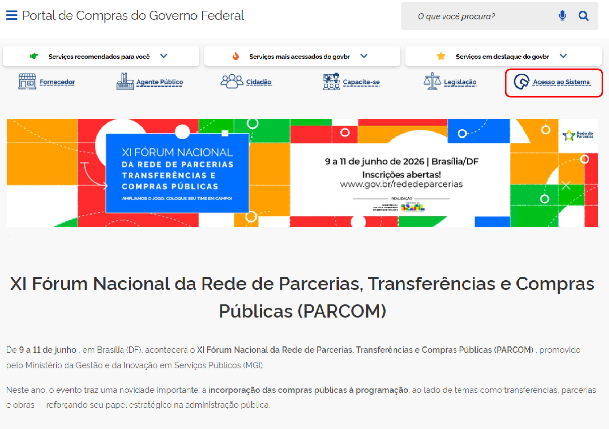

**Passo 2:** Escolha o perfil “Governo” e faça o login com o gov.br. 

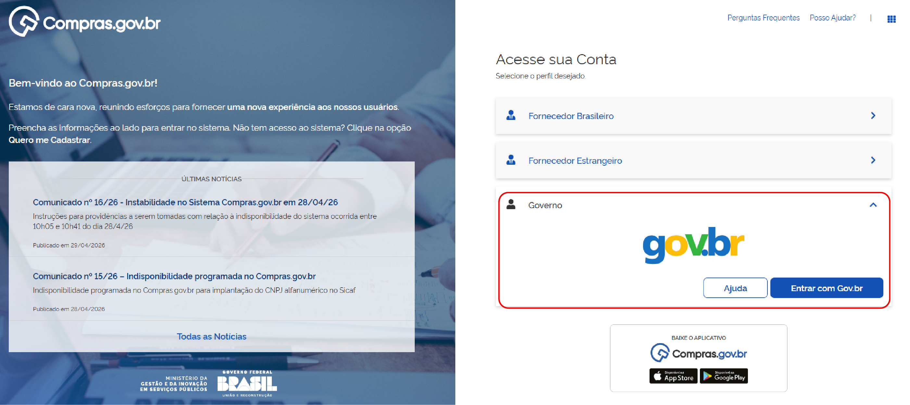

**Passo 3:** Acesse o módulo “Novo Divulgação de Compras” (Novo DC). 

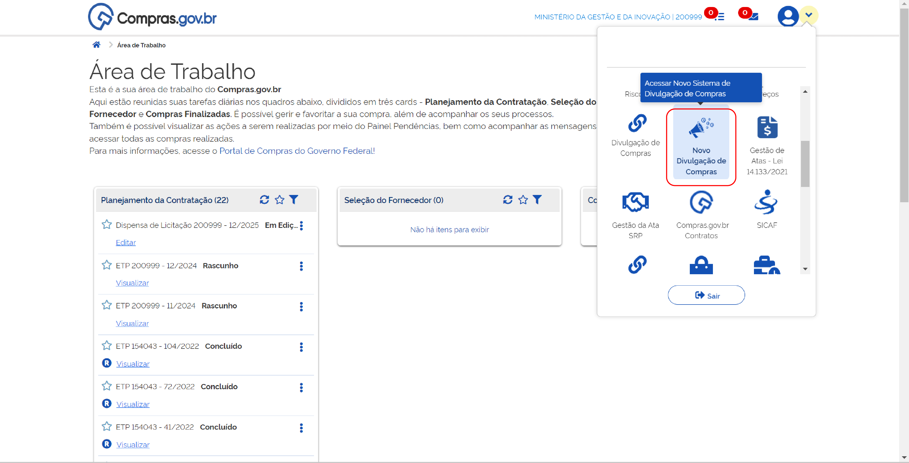

**Passo 4:** Clique na aba “Contratações em Andamento”. 

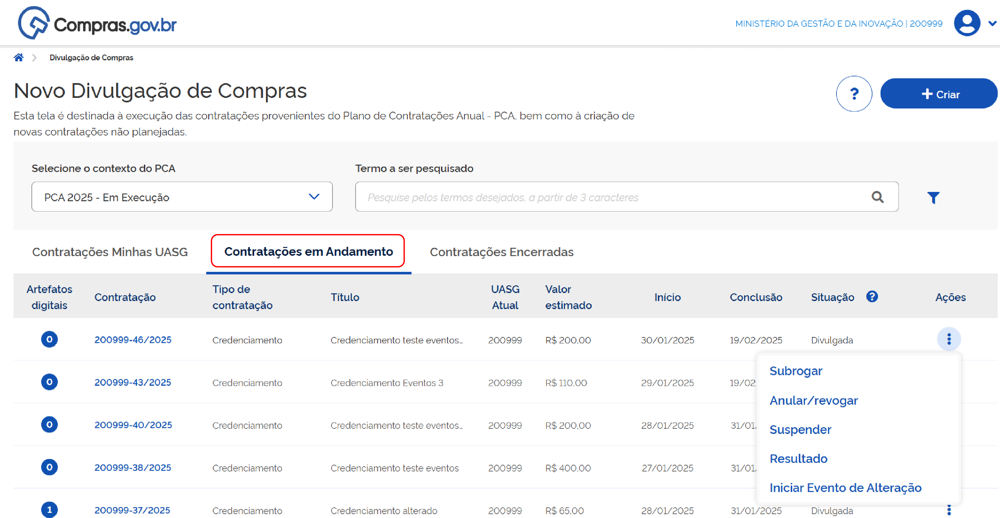

**Passo 5:** Na contratação desejada, clique nos três pontos e selecione “Suspender”. 

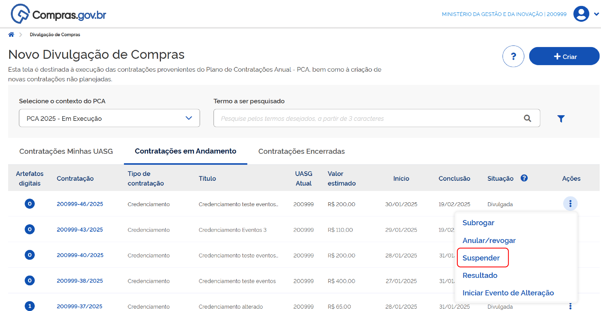

**Passo 6:** O sistema abrirá uma tela para registro do justificativa da ação. Preencha e confirme a ação. 

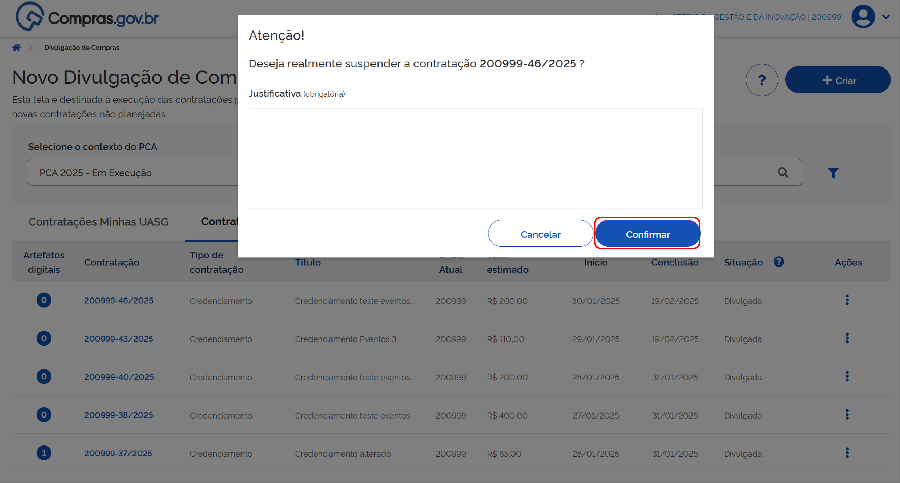

O sistema confirmará a finalização com sucesso. 

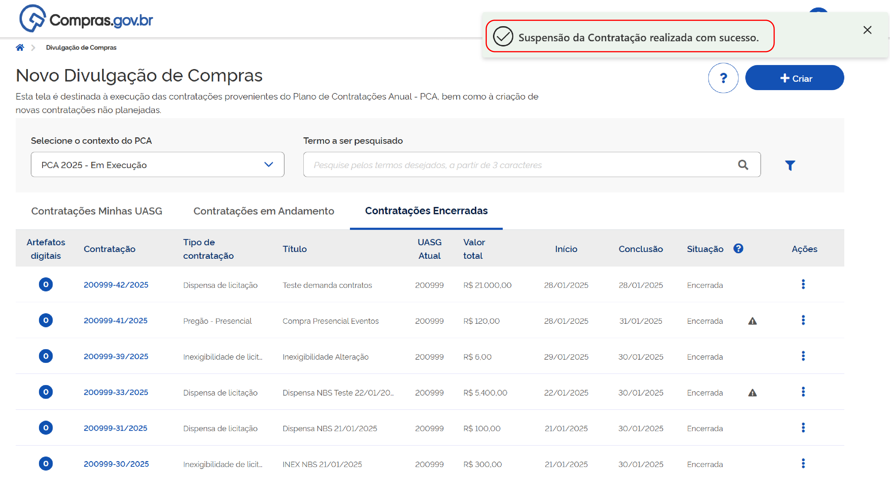

!!! warning "Atenção"
    Caso haja qualquer impedimento no sistema Contratos.gov.br (empenho ou contrato ativo relacionado ao item), o sistema emitirá alerta da existência deste impedimento e não registrará a ação.

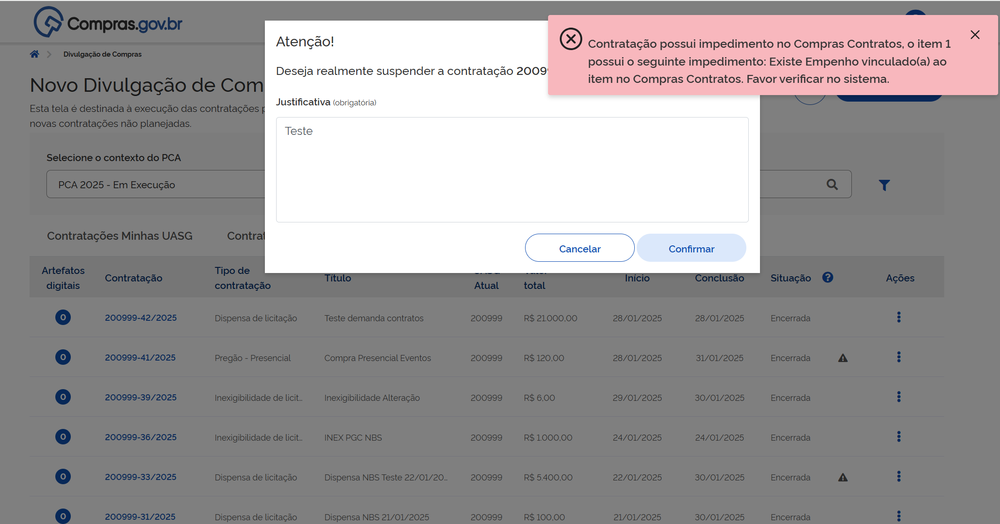

---

## Cancelamento de Evento de Suspensão

É possível cancelar o evento de suspensão.

**Passo 7:** Para cancelar um evento de suspensão, na aba Contratações em Andamento na página inicial do Novo DC, encontre a contratação desejada, clique nos 3 pontinhos e depois em “Cancelar suspensão”. 

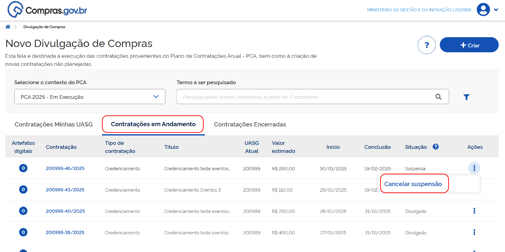

O sistema abrirá uma tela para registro da justificativa da ação. Preencha e confirme a ação. 

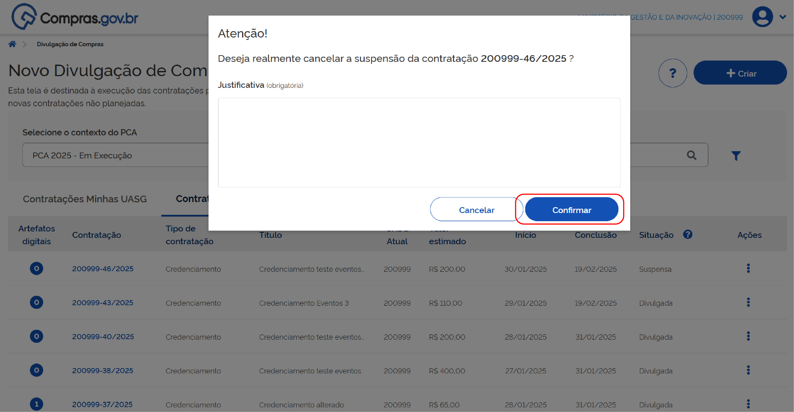

O sistema confirmará a finalização com sucesso. 

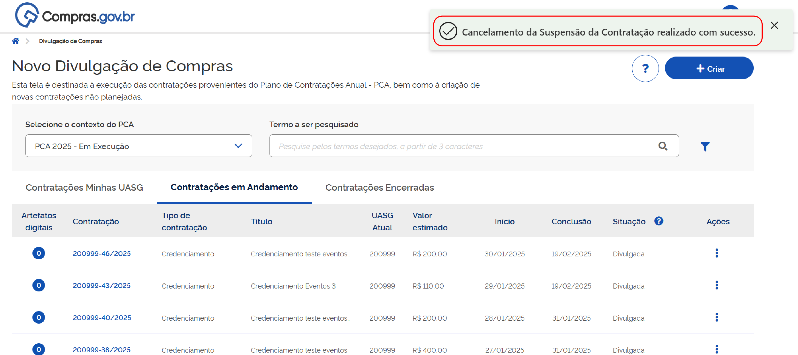

 

  <button onclick="window.print()" style="background-color: #0056b3; color: white; padding: 10px 20px; border: none; border-radius: 5px; font-size: 16px; cursor: pointer; box-shadow: 0 2px 4px rgba(0,0,0,0.2);">
    🖨️ Imprimir ou baixar esta página
  </button>

